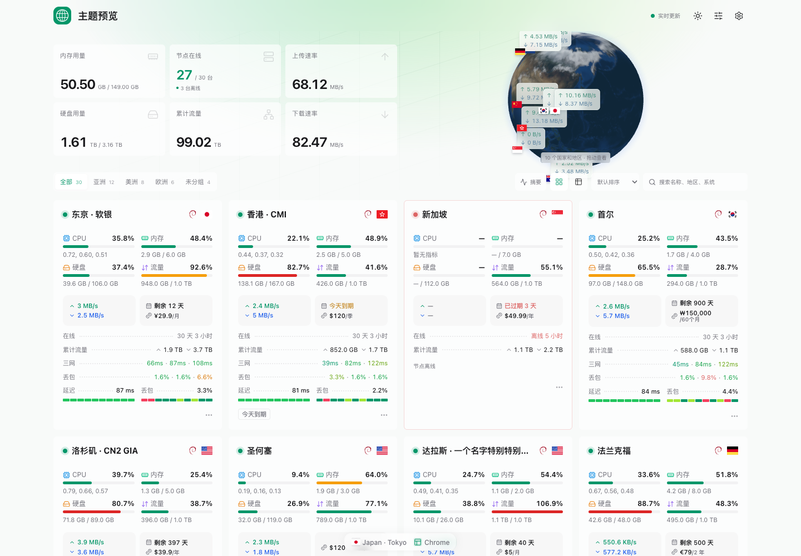

# 青屿 · Qingyu

Qingyu 是 [Monitor](https://github.com/monitor-probe/monitor) 的服务器监控主题，以翡翠绿、交互地球和半透明卡片展示节点状态，提供节点详情、资源趋势、网络延迟历史和费用计算。支持桌面与移动端、浅色与深色外观。

[下载最新版本](https://github.com/allen0039/monitor-theme-Qingyu/releases/latest) · [更新日志](CHANGELOG.md) · [反馈问题](https://github.com/allen0039/monitor-theme-Qingyu/issues)



预览图使用 Monitor 官方示例数据，访客地区为模拟结果。

## 安装

需要已部署并启用公开页的 Monitor 主控。

1. 从 [最新 Release](https://github.com/allen0039/monitor-theme-Qingyu/releases/latest) 下载 **`theme.tar.gz`**。
2. 登录 Monitor 后台，在「主题」页上传安装包。
3. 选择 **青屿 · Qingyu**，刷新公开首页。
4. 在主题设置中调整配色、公告、首页布局、节点指标和其他选项。

也可以在后台的「从 GitHub 安装」中填写仓库地址：

```text
https://github.com/allen0039/monitor-theme-Qingyu
```

GitHub 自动提供的 **Source code** 压缩包用于开发，不能作为主题安装包上传。主题使用 Monitor 的同源接口，无需填写 API Key；后台管理仍使用 Monitor 原有的 `/admin`。

### 从旧版升级

从 **v0.2.16** 起，主题安装标识统一为 `qingyu`，npm 包名为 `monitor-theme-qingyu`。

此前使用旧安装标识的版本会与 Qingyu 并存。安装新版后，请选择「青屿 · Qingyu」，并在新主题中重新填写原有公告、背景等后台配置；确认生效后再删除旧主题。相同站点、相同浏览器中的显示偏好、个人计算器选择、汇率与访客缓存、延迟平滑选项会自动迁移，已有 Qingyu 偏好优先。

后续采用 `qingyu` 标识的版本按同一主题更新，无需重复迁移。

### 校验与手动安装

将 `theme.tar.gz` 和 `theme.tar.gz.sha256` 下载到同一目录后校验：

```bash
sha256sum -c theme.tar.gz.sha256
# macOS
shasum -a 256 -c theme.tar.gz.sha256
```

需要手动安装时，将压缩包解压到主控实际使用的主题目录。例如：

```bash
mkdir -p /opt/monitor/data/themes/qingyu
tar -xzf theme.tar.gz -C /opt/monitor/data/themes/qingyu
```

路径需按部署方式调整。解压后 `theme.json` 和 `dist/` 应直接位于 `qingyu` 目录内。

## 功能

### 首页与节点浏览

- 交互地球、静止地球、点状地图、仅总览和隐藏头部五种展示模式；WebGL 不可用时自动回退到地图。地区标记使用国家中心点。
- 默认展示内存、剩余价值、上传、硬盘、累计流量和下载六张总览卡片，可自定义指标、顺序及当前分组／全站范围。
- 节点卡片与列表切换、四种卡片尺寸、分组筛选、搜索、排序和离线后置。
- CPU、负载、内存、硬盘、实时速率、本期与累计流量、在线时长、到期提醒和公开备注。
- 网络延迟摘要与线路明细，展示延迟、窗口丢包率和采样色条，支持配置线路顺序与显示数量。
- WebSocket 实时更新、断线重连及 HTTP 轮询回退；提供离线、未上报、空列表和请求失败等状态提示。

### 节点详情

点击节点卡片或列表项进入详情，可查看主机信息、实时资源、流量与计费信息，并在当前范围内切换节点。返回首页时恢复列表位置与焦点。

详情包含 CPU、内存、硬盘和网络速率趋势，以及多线路延迟历史。支持时间范围切换、峰值展示、悬停读数和延迟平滑开关。开启延迟平滑后，单次短时缺测以虚线过渡；关闭平滑时直接断开，超时与长断档始终断开。历史时间范围取决于主控保留时长，旧主控未提供该信息时仅展示 1 小时与 6 小时选项。

详情链接使用 `#/node/节点ID`，可直接分享，无需额外配置服务端路由。可用字段和历史数据由 Monitor 主控决定。

### 费用与个人计算器

点击首页「剩余价值」卡片查看公开费用汇总；右上角钱包按钮打开个人计算器，支持搜索、分组筛选、勾选节点和币种切换。个人选择只保存在当前浏览器，不改变全站汇总。

总价值使用主控录入的付款周期标价，月均费用按付款月数摊销，例如年付 ¥1,200 折算为 ¥100/月。剩余价值按付款周期与主控提供的剩余天数线性估算，已到期归零；缺少价格、周期、到期或汇率信息时显示未知或注明未计入。计算结果用于估算，主控接口未提供独立的历史购入价和续费报价。

支持多币种汇总，汇率每日按北京时间检查缓存。网络获取失败时使用缓存或明确标注参考汇率。站点关闭费用展示，或限制未登录用户查看费用时，相关金额与计算入口遵守该设置。

## 配置

在 Monitor 后台主题设置中配置全站默认值；首页右上角「显示设置」调整当前浏览器的个人偏好。

| 分区 | 主要选项 |
| --- | --- |
| 基础与外观 | 配色、卡片／列表、卡片尺寸、站点图标、断线刷新、减弱动画 |
| 首页布局与地球 | 公告、头部模式、地球自转、国旗、地区速率、在线状态、分组与搜索 |
| 首页总览 | 指标方案、自定义指标与顺序、当前分组／全站统计 |
| 节点卡片与列表 | 排序、离线后置、资源与流量显隐、主机信息、到期与备注 |
| 网络延迟 | 摘要／明细、线路顺序、线路数量、缓存与刷新间隔 |
| 费用与隐私 | 费用显隐、汇总币种、个人计算器、未登录费用与后台入口显隐 |
| 背景与页脚 | 浅色／深色背景、模糊、不透明度、网格、访客气泡、页脚文字与链接 |

配色支持跟随系统、浅色、深色和北京时间自动；自动模式按北京时间 06:00–18:00 使用浅色，其余时间使用深色。尊重系统「减少动态效果」。站点图标留空时使用内置服务器监控图标，也可填写自己的图片地址。

个人偏好优先于站点默认值；「恢复站点默认」清除个人显示覆盖。公告、站点图标、页脚和登录隐私规则由后台管理，个人设置不能开启站点已关闭的费用、计算器或延迟功能。浏览器禁用存储时仍可调整当前页面，并显示未保存提示。

### 外部请求与显示边界

- 汇率使用 Frankfurter 和 open.er-api；费用功能不需要汇率时不会请求。
- 访客气泡向 ip.sb 查询网络出口地区，失败时回退 ipwho.is；当前标签页缓存 15 分钟。关闭访客气泡后不请求定位，也不显示地球访客连线。
- 图标、国旗和地球资源随构建提供，运行时无需通过 CDN 加载这些资源。
- 主题设置控制页面展示；隐藏费用或后台入口不会改变主控 API 权限，私有字段由 Monitor 后端控制。

## 本地开发

使用满足 [package.json](package.json) `engines` 要求的 Node.js，推荐 Node.js 24。

```bash
npm ci
npm run dev:demo
```

`dev:demo` 使用 Monitor 官方主题站的示例脚本，提供节点、分组、计费和 gzip 推送数据。示例脚本只在开发服务器中注入，正式构建不会包含它。

接入自己的主控进行开发：

```bash
MONITOR_HUB=https://monitor.example.com npm run dev
```

将示例地址替换为已启用公开页的主控地址；不设置时，开发代理默认连接 `http://127.0.0.1:9911`。

### 测试与打包

```bash
npm test
npm run package
```

打包还需要 `tar` 和 Python 3.9+，并确保两个命令在 PATH 中可用。

`package` 会执行 Vue / TypeScript 检查、生产构建、打包和安装包校验，生成 `theme.tar.gz` 与 `theme.tar.gz.sha256`。也可用 `npm run verify:package` 单独检查已有包。

安装包包含根目录的 `theme.json`、`dist/`、许可证和预览图。校验覆盖 gzip 完整性、路径、文件大小与数量、主题字段、图标约定和开发脚本排除。

### 发布

同步更新 `package.json`、`package-lock.json`（含根包版本）和 `theme.json` 的版本，在 `.github/release-notes/` 添加以完整标签命名的版本说明，例如版本 `0.2.17` 使用 `v0.2.17.md`，再推送同版本的 `v*` 标签。

[发布工作流](.github/workflows/release.yml) 会检查版本与仓库地址、运行测试、构建安装包，并将安装包及 SHA256 文件发布到 GitHub Release。手动触发工作流只构建并上传 Actions 产物。

## 来源与许可

Qingyu 基于 [Komari Emerald Globe Pro](https://github.com/allen0039/komari-theme-emerald-globe-pro) 的视觉设计、地球纹理与国家中心点适配到 Monitor，保留 Tokinx / Davies_Allen 的 MIT 署名。接口与安装格式参考 [Monitor](https://github.com/monitor-probe/monitor) 及其 [默认主题](https://github.com/monitor-probe/monitor-theme-default)，开发示例脚本来自 [Monitor 官方主题站](https://github.com/monitor-probe/themes)。

项目采用 [MIT 许可证](LICENSE)。地图、图标、国旗及其他依赖的声明见 [THIRD_PARTY_LICENSES.md](THIRD_PARTY_LICENSES.md)。
