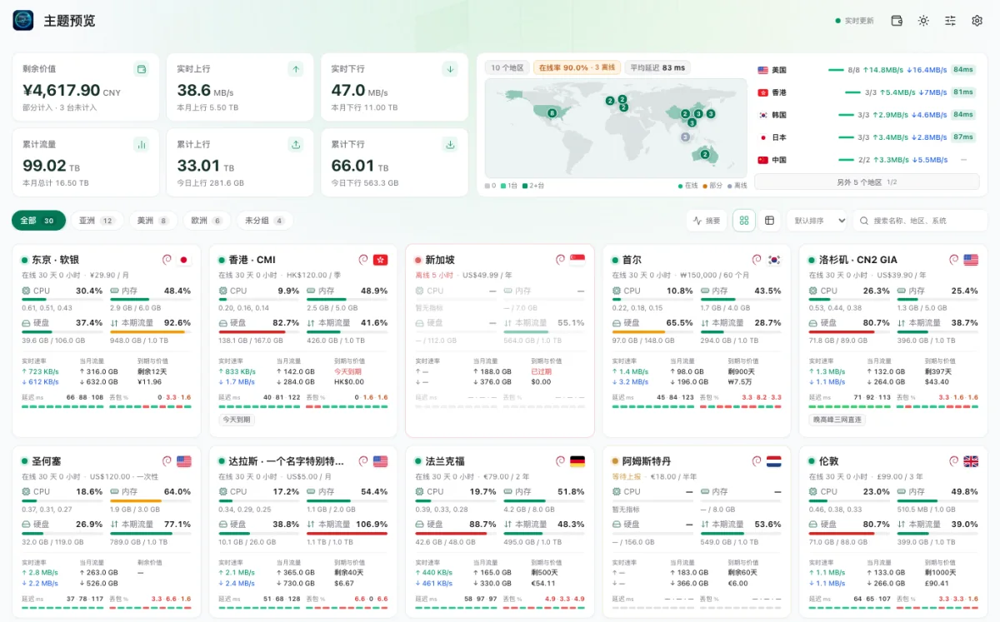

# 青屿 · Qingyu

Qingyu 是 [Monitor](https://github.com/monitor-probe/monitor) 的翡翠绿主题，面向公开监控首页和节点详情页。它把节点状态、点状世界地图、流量汇总、网络质量和费用信息放在同一套响应式界面中，支持浅色、深色、桌面和手机屏幕。

[下载最新版本](https://github.com/allen0039/monitor-theme-Qingyu/releases/latest) · [更新日志](CHANGELOG.md) · [问题反馈](https://github.com/allen0039/monitor-theme-Qingyu/issues)



预览图使用 Monitor 官方示例数据，访客地区为模拟结果。当前最新版本为 **v0.2.43**。

## 安装

需要已经部署并启用公开页的 Monitor 主控。

1. 从 [最新 Release](https://github.com/allen0039/monitor-theme-Qingyu/releases/latest) 下载 `theme.tar.gz` 和可选的 `theme.tar.gz.sha256`。
2. 登录 Monitor 后台，打开「主题」并上传安装包。
3. 选择「青屿 · Qingyu」，刷新公开首页。
4. 在主题设置或首页「显示设置」中调整外观、地图、总览卡片和节点信息。

也可以在后台的「从 GitHub 安装」中填写仓库地址：

```text
https://github.com/allen0039/monitor-theme-Qingyu
```

GitHub 自动生成的 Source code 压缩包是源码归档，不能替代 `theme.tar.gz` 上传。主题使用 Monitor 的同源接口，不需要额外填写 API Key。后台管理继续使用 Monitor 原有的 `/admin`。

### 校验安装包

将两个发布附件放在同一目录后执行：

```bash
# Linux
sha256sum -c theme.tar.gz.sha256

# macOS
shasum -a 256 -c theme.tar.gz.sha256
```

手动安装时，把压缩包解压到主控实际使用的主题目录：

```bash
mkdir -p /opt/monitor/data/themes/qingyu
tar -xzf theme.tar.gz -C /opt/monitor/data/themes/qingyu
```

解压后，`theme.json` 和 `dist/` 应直接位于 `qingyu` 目录内。目录位置按你的部署方式调整。

### 从旧版升级

从 v0.2.16 起，主题安装标识统一为 `qingyu`，npm 包名为 `monitor-theme-qingyu`。使用旧安装标识的版本会与 Qingyu 并存，安装后请在主题列表中选择「青屿 · Qingyu」，并在新主题中重新填写后台配置。

同一站点、同一浏览器中的页面配色、个人总览选择、汇率选择、访客缓存和延迟平滑偏好会自动迁移。后续使用 `qingyu` 标识的版本可以直接覆盖升级。

## 功能

### 首页

- 点状世界地图按节点数量为地区着色，标记显示节点数量及在线、部分在线或离线状态。地区列表显示国旗、在线台数和实时上下行。
- 六个及以内的地区直接显示。超过六个时，每页显示五条，可用「更多地区」按钮循环翻页，也可用滚轮逐页浏览。地图始终保留全部地区标记。
- 地图显示当前分组的在线率。开启延迟监控后，地图与地区列表复用节点卡片已加载的近一小时采样，未获得可用采样时显示 `—`。
- 默认总览包含剩余价值、实时上行、实时下行、累计流量、累计上行和累计下行。累计上下行在对应方向的日数据完整时显示今日读数，缺报时显示本月数据。
- 总览卡片支持资源、网络、状态、完整和自定义方案，可选择当前分组或全部节点作为统计范围。
- 节点支持卡片和列表两种视图，提供迷你、紧凑、舒适和宽松四种卡片尺寸，以及分组、搜索、排序和离线后置。
- 节点卡片显示 CPU、负载、内存、硬盘、实时速率、本期流量、累计流量、在线时长、到期提醒、剩余价值和公开备注。
- 网络摘要和线路明细分别展示延迟、丢包和采样状态。线路顺序、数量、摘要或明细模式可以配置。
- WebSocket 连接实时更新。连接不可用时自动使用 HTTP 轮询，并显示离线、等待上报、空列表和请求失败状态。

### 节点详情

点击节点卡片或列表项进入 `#/node/节点ID` 详情页。详情页支持直接打开、刷新、浏览器前进后退和节点切换，返回首页时恢复筛选、视图、滚动位置和焦点。

详情页包含：

- CPU、内存、硬盘和网络速率趋势
- 多线路延迟历史、窗口丢包率、最新读数和线路筛选
- 时间范围切换、峰值显示、悬停读数和延迟平滑
- 主机硬件、系统、Agent、上报时间、流量配额和计费信息
- 公开备注与可用的地址信息

延迟平滑只改变曲线绘制，悬停读数、最新延迟和丢包率仍使用原始数据。短暂缺测可以连续绘制，长时间断档和明确超时保持断开。历史时间范围由主控保留天数决定，旧主控只提供保守的短时间范围。

### 费用与流量

首页「剩余价值」卡片可以打开公开费用汇总。右上角钱包入口打开个人计算器，支持搜索、分组筛选、勾选节点和币种切换。个人选择保存在当前浏览器，不改变全站汇总。

费用按主控录入的价格、付款周期和剩余天数估算。年付、季付和自定义周期会折算为月均金额，缺少价格、周期、到期或汇率信息时显示未知或未计入。结果是估算值，不代表退款余额。

费用展示遵守主控的登录和隐私限制。关闭费用或个人计算器后，主题不会通过个人偏好绕过主控设置。

## 配置

Monitor 后台主题设置提供站点默认值：首页右上角「显示设置」用于当前浏览器的个人偏好。

| 分区 | 可配置内容 |
| --- | --- |
| 基础与外观 | 跟随系统、浅色、深色或北京时间自动，卡片／列表，卡片尺寸，图标，断线刷新，减弱动画 |
| 首页布局与地图 | 公告、地图或仅总览、地图节点数量、在线状态、分组、搜索、排序 |
| 首页总览 | 总览开关、指标方案、自定义卡片与顺序、当前分组／全部节点 |
| 节点卡片与列表 | 排序、离线后置、CPU、内存、硬盘、速率、流量、主机信息、到期与备注 |
| 网络延迟 | 摘要／明细、线路顺序、线路数量、缓存与刷新间隔 |
| 费用与隐私 | 费用显隐、汇总币种、个人计算器、未登录费用和后台入口显隐 |
| 背景与页脚 | 背景颜色、模糊、不透明度、网格、访客信息、页脚文字与链接 |

个人偏好优先于站点默认值。「恢复站点默认」会清除个人显示覆盖。个人设置不能重新开启站点已关闭的费用、计算器或延迟功能。浏览器禁用存储时仍可以调整当前页面，但刷新后不会保留个人选择。

### 外部请求与数据边界

- 汇率仅在费用功能需要时请求 Frankfurter 或 open.er-api，并优先使用缓存。
- 访客信息向 ip.sb 查询出口地区，失败时回退 ipwho.is。关闭访客信息后不发起定位请求。
- 国旗、地图和图标随主题构建提供，页面使用系统字体。
- 主题控制页面展示和个人偏好。节点权限、私有字段和接口访问由 Monitor 主控决定。

## 本地开发

使用满足 [package.json](package.json) `engines` 要求的 Node.js，推荐 Node.js 24。

```bash
npm ci
npm run dev:demo
```

`dev:demo` 通过开发服务器注入 Monitor 官方示例数据，包含节点、分组、费用、流量和延迟响应。示例脚本不会进入正式构建。

接入自己的主控进行开发：

```bash
MONITOR_HUB=https://monitor.example.com npm run dev
```

不设置 `MONITOR_HUB` 时，开发代理默认连接 `http://127.0.0.1:9911`。地址替换为已启用公开页的 Monitor 主控。

### 测试与打包

```bash
npm test
npm run typecheck
npm run package
```

`npm run package` 会执行类型检查、生产构建、主题打包和安装包校验，并生成 `theme.tar.gz` 与 `theme.tar.gz.sha256`。主题包包含根目录的 `theme.json`、`dist/`、许可证和 Monitor 后台使用的 `preview.png`。本页使用 `preview.webp` 展示更清晰的首页预览。也可以用下面的命令单独校验已有安装包：

```bash
npm run verify:package
```

校验覆盖 gzip 完整性、路径安全、文件数量和大小、manifest 版本、图标路径、开发脚本排除以及本地用户路径脱敏。

### 发布

发布前同步更新 `package.json`、`package-lock.json` 根包版本和 `theme.json` 版本，并在 `.github/release-notes/` 添加对应标签的说明。例如版本 `0.2.43` 使用 `v0.2.43.md`。

推送匹配的 `v*` 标签后，[发布工作流](.github/workflows/release.yml) 会检查版本和仓库地址，运行测试，构建安装包，并创建 GitHub Release。工作流也会上传 `theme.tar.gz`、SHA256 文件和 Actions 构建产物。

## 来源与许可

Qingyu 基于 [Komari Emerald Globe Pro](https://github.com/allen0039/komari-theme-emerald-globe-pro) 的视觉设计和国家中心点适配到 Monitor，保留 Tokinx / Davies_Allen 的 MIT 署名。接口和安装格式参考 [Monitor](https://github.com/monitor-probe/monitor) 及其[默认主题](https://github.com/monitor-probe/monitor-theme-default)，开发示例脚本来自 [Monitor 官方主题站](https://github.com/monitor-probe/themes)。

项目采用 [MIT 许可证](LICENSE)。地图、图标、国旗及其他依赖的声明见 [THIRD_PARTY_LICENSES.md](THIRD_PARTY_LICENSES.md)。
